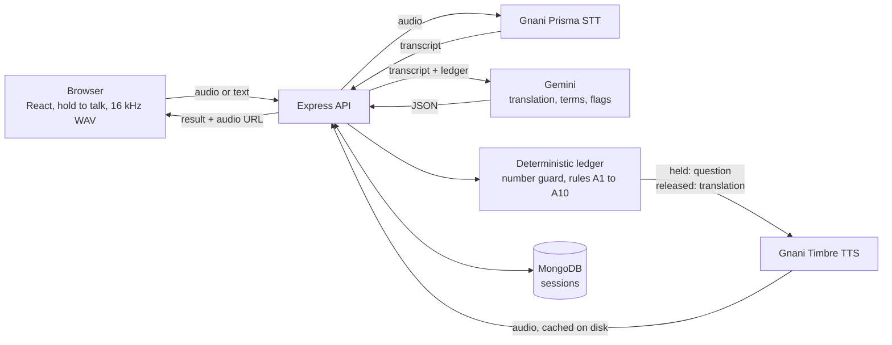

# Pakka

Pakka is a voice deal-guard for cross-language trade. A Gujarati-speaking seller and a Hindi or Hinglish-speaking buyer each talk in their own language by push-to-talk on one laptop. Pakka transcribes, translates and speaks the message to the other side, but when a quantity, price, date or tax term could mean two things, it holds the message and asks the speaker one short question with tap options. At the end both sides get one confirmed terms card in both languages, read aloud, with a JSON download.

Pakka is a hackathon MVP for the Great Indian AI Internship Challenge by Gnani AI. The name is the Hindi and Gujarati word for firm or confirmed.

## Who it is for

Small traders and buyers who do not share a language, for example a Surat textile seller and a Hindi-speaking buyer. A missing unit ("500 what?"), an unstated GST term or a vague date ("next Friday") is cheap to ask about before the deal and expensive to argue about after it.

## Live links

Not deployed yet. Pakka runs locally only. See `docs/OPERATIONS.md` for free hosting options that are not set up.

## What is Gnani and what is not

| Part | Provider | What it does |
|---|---|---|
| Speech to text | Gnani Prisma STT (`prisma-v3.0`) | Turns the speaker's recording into a transcript |
| Text to speech | Gnani Timbre TTS (`timbre-v3.0`) | Speaks the translation, the clarification question and the confirmed card |
| Translation | Gemini (model set by `GEMINI_MODEL`) | Translates the transcript into the listener's language |
| Ambiguity reasoning | Gemini plus our own rules | Gemini flags unclear product spec, ambiguous assent and currency. Code checks everything else |
| Terms ledger and gate | Our code (`backend/src/ledger.js`, `deal.js`) | Checks every slot, parses Indian number words, guards numbers, decides what is held |

Gnani provides speech in and speech out. There is no Gnani translation API, so Gemini does translation and part of the ambiguity reasoning. This is stated on purpose: the audio path is Gnani, the language reasoning is not.

## How it works



Details are in `docs/ARCHITECTURE.md`.

## Run locally

You need Node 22 (see `.nvmrc`), MongoDB running locally, and two keys.

### 1. Database

Install MongoDB Community Server for Windows and start it, or run `mongod` in a separate PowerShell window. The default connection string is `mongodb://127.0.0.1:27017/pakka`.

### 2. Keys

| Key | Where to get it | Goes in |
|---|---|---|
| `GNANI_API_KEY` | app.gnani.ai/voice | `backend/.env` |
| `GEMINI_API_KEY` | aistudio.google.com | `backend/.env` |

Add both yourself. Do not paste keys into chat, issues or commits. `.env` is git-ignored.

### 3. Backend (PowerShell)

```powershell
cd backend
copy .env.example .env
# edit .env: set GNANI_API_KEY and GEMINI_API_KEY
npm install
npm run dev
```

The API listens on http://localhost:4000. If a required variable is missing, it exits and names the variable.

### 4. Frontend (second PowerShell window)

```powershell
cd frontend
npm install
npm run dev
```

Open http://localhost:5173. Hold a talk button and speak, or use the "type instead" box for a text turn (no Gnani speech-to-text credit is used for text turns).

## Tests and evaluation

```powershell
cd backend
npm test

cd ..\frontend
npm test
```

The backend tests use `mongodb-memory-server` and mocked providers, so they need no keys and no running MongoDB. The frontend test covers the WAV encoder.

```powershell
cd backend
npm run eval
```

`npm run eval` runs 30 labelled dialogues through the real Gemini call and the ledger rules, using text only (no Gnani credits). It needs `GEMINI_API_KEY`. Flags: `--only d01,d07`, `--limit 5`. It prints per-type and overall precision and recall, false alarms on clean dialogues and every failing dialogue, and writes `backend/eval/results.json`.

## Evaluation

Results are not measured yet. No eval has been run with a real Gemini key. This table is filled in after the first `npm run eval`.

| Type | Precision | Recall |
|---|---|---|
| A1 to A10, overall | not measured | not measured |

Of the 30 dialogues, 10 are clean (expected no flags). The scorer counts a type as detected when it appears at least once in a dialogue, so the numbers are per dialogue, not per turn.

## Tech stack

| Layer | Choice | Why |
|---|---|---|
| Frontend | React 19, Vite, TypeScript, Tailwind v4 | Default stack, fast to build and run |
| Audio capture | MediaRecorder, then Web Audio resample to 16 kHz mono WAV in the browser | Gnani does not list webm; no ffmpeg needed on the server |
| Backend | Express 5, Mongoose, ESM JavaScript | MERN as asked; plain JavaScript saved time before the deadline |
| Database | MongoDB | Replay needs stored sessions; Atlas free tier is an option |
| Speech | Gnani Prisma STT and Timbre TTS over REST | The challenge technology; REST is enough for push-to-talk turns |
| LLM | Gemini `generateContent` with a response schema, behind one function `analyseTurn()` | One swap point; JSON output is validated before use |
| Tests | Vitest, Supertest, mongodb-memory-server | Real Express app and Mongoose models, mocked providers, no real database |
| Lint | oxlint | Comes with the current Vite template |

## Known limits

- Question, option and card templates in Gujarati and Hindi (`backend/src/templates.js`) have not been checked by a native speaker.
- Numbers are passed to TTS as digits. Timbre may read numbers better as words.
- Single laptop, push-to-talk only. No two devices, no streaming, no telephony.
- The number-word parser covers 1 to 20, the tens (30 to 90), hundred, thousand, lakh, crore, and the fraction words dedh, dhai, sava, paune and saade. It does not cover every compound such as 21 to 29 spoken as one word.
- The Gemini model name `gemini-2.5-flash` is an assumption. If Google has retired it, set `GEMINI_MODEL`.
- The 25 second recording cap is enforced in the browser. The server only limits the upload to 2 MB.
- Timbre voices `Shivani` and `Avinash` have not been checked by ear.
- No live smoke test with real keys has been run yet.

## Synthetic data only

All dialogues, prompts and test audio are synthetic or recorded by the team. Do not use real phone numbers, bank details, Aadhaar, PAN or recordings of real calls. Pakka has no accounts and no authentication, so do not expose it on the public internet with real deal data.

## Documentation

| File | Contents |
|---|---|
| `docs/ARCHITECTURE.md` | One turn step by step, the question queue, ledger rules, decisions |
| `docs/API.md` | Every endpoint with request and response examples |
| `docs/ENVIRONMENT.md` | Every environment variable |
| `docs/OPERATIONS.md` | Running, cache, rate limits, hosting options, steps you must do yourself |
| `CHANGELOG.md` | Release notes |
